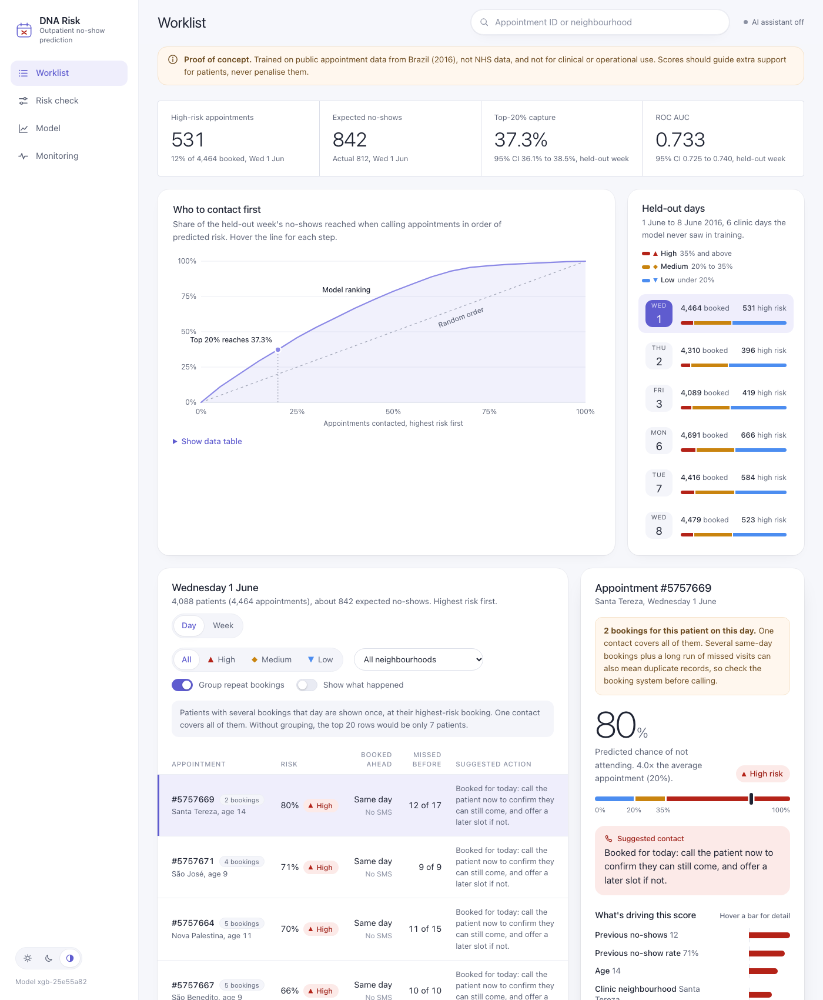
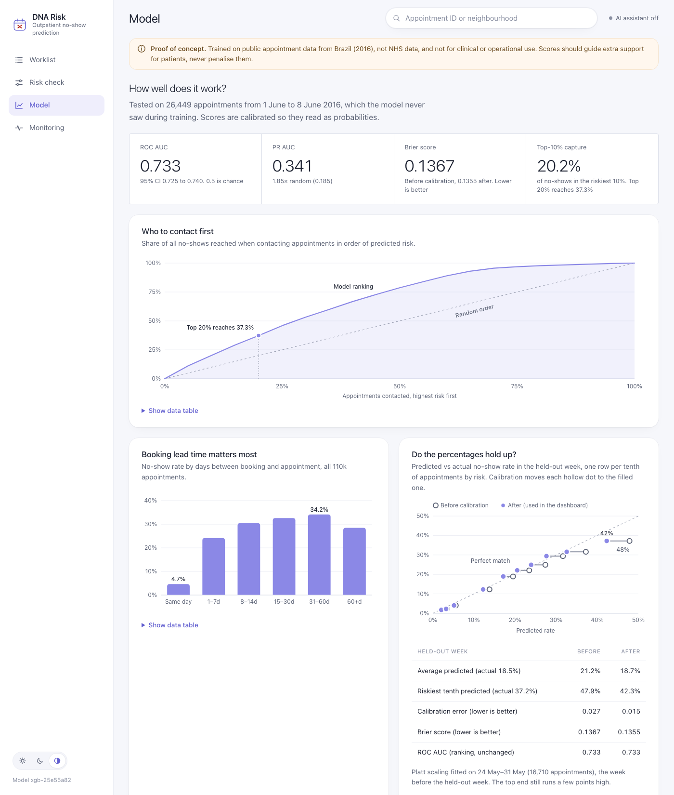
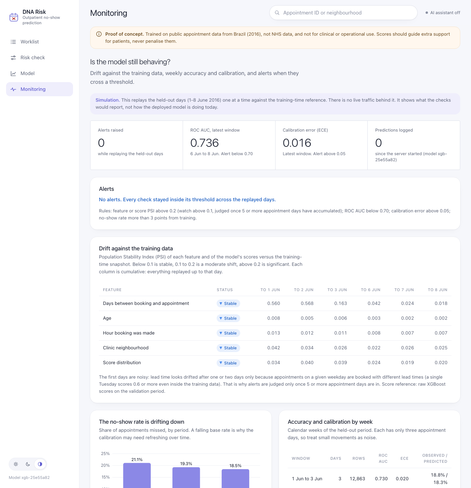
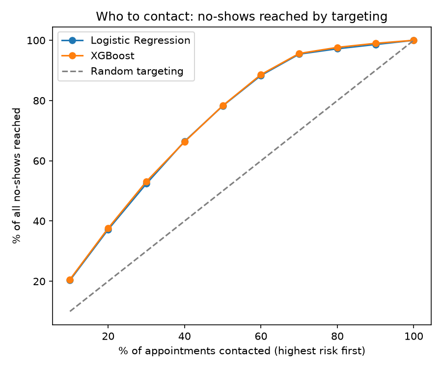
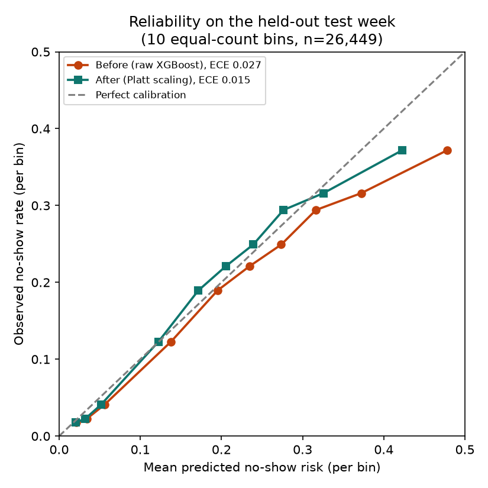

# Outpatient no-show (DNA) risk dashboard

> **Proof of concept on public data.** Built on the Kaggle *Medical Appointment No Shows* dataset (Brazil, 2016). It is **not NHS data** and **not for clinical or operational use**.

Missed outpatient appointments ("Did Not Attend", DNA) waste clinic capacity and delay care for other patients. This project scores each upcoming appointment for no-show risk, explains every score with SHAP, and suggests who clinic staff should contact first.

Headline result: contacting the top 20% of appointments by predicted risk reaches 37% of all no-shows (about 1.9x random), with ROC AUC 0.733 on later dates the model never saw.

**Live demo:** [huggingface.co/spaces/Baafi02/dna-risk-dashboard](https://huggingface.co/spaces/Baafi02/dna-risk-dashboard) · **Code:** [github.com/baafibk-source/outpatient-no-show-risk](https://github.com/baafibk-source/outpatient-no-show-risk)



| Model | Monitoring |
|---|---|
|  |  |

## Results (held-out later dates)

The model is trained on earlier appointments and tested on later ones, which mirrors real use: a clinic scores *future* appointments using past attendance. The numbers below are for the model the dashboard ships (the reduced-feature model, see [Fairness](#fairness)).

| Measure | Result |
|---|---|
| ROC AUC (XGBoost) | **0.733** (95% CI 0.725–0.740) |
| ROC AUC (logistic regression baseline, same features) | 0.728 |
| PR AUC (a random model scores 0.185) | 0.341 |
| Contact the top 20% highest-risk appointments | reaches **37.3%** of all no-shows (95% CI 36.1–38.5%), about 1.9x random |
| Calibration after Platt scaling | ECE 0.027 to 0.015; mean predicted risk 18.7% vs 18.5% observed |
| Brier score (raw to calibrated) | 0.1367 to 0.1355 |

Test set: 26,449 appointments from 1–8 June 2016 (six appointment days). Confidence intervals resample **patients**, not rows, because one patient can have several appointments. ECE uses 10 equal-count bins (see `calibrate_noshow.py`). All figures are produced by the scripts below and saved in `outputs/metrics.json`, `outputs/calibration.json` and `outputs/fairness_*.csv`.



### What the model can and can't do

I tested how much each part of the model contributes, and the answer is modest:

| Model | ROC AUC |
|---|---|
| Booking lead time only | 0.688 |
| All features except patient history | 0.720 |
| All features | 0.733 |
| Logistic regression, all features | 0.728 |

Booking lead time does most of the work: same-day bookings are missed about 5% of the time, against 24–34% for bookings made one or more days ahead. Patient history and XGBoost each add a small gain. I kept XGBoost for its handling of non-linear effects and for SHAP explanations, but a plain logistic regression is nearly as good. The value of the project is in the decision workflow around the score, not in a large accuracy gain.

Scores are calibrated, so they read as probabilities. The top decile is still over-predicted after calibration (42% predicted vs 37% observed), so treat very high scores as "high risk" rather than as exact probabilities.



## How it supports a decision

| Risk band | Predicted risk | Suggested action |
|---|---|---|
| High | 35% and above | Phone the patient a few days before and offer to rebook if the time no longer suits |
| Medium | 20–35% | Send an SMS or automated reminder |
| Low | under 20% | Standard process, no extra contact |

Short-notice bookings get an adjusted action (for example, "call today") because there is no time for a call "days before". Several appointments for one patient on one day are collapsed into a single contact, so staff are not sent the same patient repeatedly. In the test week, patients in the High band missed their appointment about 37% of the time against about 8% in the Low band. The 20% and 35% cut-offs are fixed operational choices, not learned from the data. The model should be used to offer extra support, never to penalise patients.

## How it works

- **Data:** 110,516 appointments from 62,296 patients after cleaning (29 April to 8 June 2016). Cleaning removes duplicate IDs, impossible ages and appointments booked after their date, and the counts are printed by `prep_noshow.py`.
- **Features (16):** booking timing (lead time, weekday, booking hour, SMS reminder), age, three recorded conditions, patient attendance history and clinic neighbourhood. Neighbourhoods with fewer than 50 rows in the training data (7 of 81) are grouped into "Other", and unseen neighbourhoods at prediction time map to "Other" too.
- **No leakage from patient history.** History features use only appointments on **earlier dates**. A patient can have several appointments on one day, so history is aggregated per patient-day and then shifted, which stops same-day outcomes leaking into each other. `tests/test_prep.py` checks this. In a one-off check (not part of the repo), I compared the history counts with a brute-force recomputation on 3,000 random rows and found no mismatches. As a further one-off check, limiting history to outcomes known 1, 3 or 7 days before the appointment left AUC at 0.732–0.733.
- **Validation design:** train on the earliest dates (to 23 May, 67,357 rows), a validation period for early stopping and calibration (24–31 May, 16,710 rows), and a final test period touched once (1–8 June, 26,449 rows).
- **Model:** XGBoost without class re-weighting, so predicted probabilities stay meaningful. Logistic regression is the baseline.
- **Calibration:** Platt scaling fitted on the validation period. Method chosen by leave-one-day-out Brier score (Platt 0.1386, isotonic 0.1388, raw 0.1393). The differences are small, and Platt is simpler.
- **Explainability:** SHAP values for every prediction, scaled by the calibration slope so the explanation matches the displayed risk.
- **Single source of truth:** the dashboard and its model card read `outputs/metrics.json` and `outputs/calibration.json`, so the numbers in the app cannot drift from the training scripts.

## Fairness

The full-feature model used age, sex, a welfare-programme flag and a disability flag, so I checked how it behaves across groups (`fairness_check.py`, written to `outputs/fairness_by_group.csv`, for both the full and the shipped model). Figures below are for the shipped model unless stated:

- **Sex:** accuracy and calibration are similar (AUC 0.731 for women, 0.735 for men; mean predicted risk within 0.5 points of observed). Sex is no longer a model input.
- **Age:** predictions track the real differences (13–29 year-olds miss more often than people over 65), but accuracy is lower for older patients (AUC 0.69 for 65+ vs 0.73–0.74 for 18–44), and 65+ patients are rarely flagged High (2%).
- **Welfare programme:** with all features, these patients were flagged High at **20.8%** vs **10.5%** for others, while their observed no-show rates were 20.9% vs 18.2%.

Removing `welfare_programme`, `is_male`, `has_handicap` and `n_conditions` (which contains the disability flag) costs almost nothing: **ROC AUC 0.7327 to 0.7326**. The welfare gap narrows to **16.2% vs 11.3%** but does not close, because other features, such as neighbourhood, carry related information. **The dashboard ships this reduced model**; `python model_noshow.py --drop-sensitive` trains it, and calibration is refitted on it. The Risk check form no longer asks for sex, welfare programme or disability.

## Monitoring

`monitoring/` computes PSI drift for lead time, age, booking hour and neighbourhood against a snapshot saved at training time (`outputs/reference_stats.json`), score-distribution drift, ROC AUC and ECE per calendar week, and alert rules (PSI above 0.2, ROC AUC below 0.70, ECE above 0.05, no-show rate more than 3 points from training). `GET /health` and `GET /api/monitoring` expose it, the dashboard's Monitoring page shows it, and every prediction writes one JSON log line (timestamp, score, band, model version, no personal details).

**This is a simulation.** With no live traffic, it replays the six held-out days one at a time. In that replay nothing crosses a threshold: PSI over the whole period is 0.018 for lead time, 0.002 for age, 0.007 for booking hour, 0.025 for neighbourhood and 0.020 for scores; weekly ROC AUC is 0.730 and 0.736. Drift is judged on the accumulated window once five appointment days are in, because a single weekday already scores PSI 0.5 or more on lead time against the all-days reference (weekday mix shapes booking lead time).

## Limitations

- **Public Brazilian data from 2016, not NHS data.** Patterns will differ in a UK trust.
- **Only about six weeks of history.** "No earlier visit in data" only means no earlier visit in this window: 70% of training rows have no history but only 42% of test rows do. Patient-history features would behave differently with years of data.
- **The no-show rate is drifting down** (21.1% in training, 19.3% in validation, 18.5% in test), so the calibration would need refreshing over time.
- **The SMS reminder effect is confounded with lead time** and should not be read as causal.
- **A short test window** (six days). The intervals above reflect patient-level uncertainty, not seasonal variation, and the monitoring page can only replay those six days.
- **No evidence that acting on these scores improves attendance.** That needs a trial.

## AI assistant (optional)

If an `HF_TOKEN` secret is set, the dashboard can generate plain-English staff summaries, reminder drafts and answer questions. Without a token it falls back to templates. It is rate-limited and constrained to the facts it is given, and reminder drafts are forbidden from mentioning risk scores or health details. The server builds the prompt from an appointment id or validated inputs, never from client-supplied text. **Prompts include factor values such as age and conditions, so this must never be used with real patient data**, because they are sent to an external inference provider. `PROXY_HOPS` (default 1) sets how many proxies append to `X-Forwarded-For` for the per-IP limit; I could not verify the right value for Hugging Face Spaces, so check it on your deployment.

## Reproduce

```bash
pip install -r requirements.txt
# 1. download KaggleV2-May-2016.csv from the Kaggle dataset page into this folder
python prep_noshow.py                      # clean data, build features, save noshow_features.parquet
python model_noshow.py --drop-sensitive    # the shipped model; writes outputs/metrics.json and reference_stats.json
python calibrate_noshow.py                 # Platt scaling; writes outputs/calibration.json and calibration_curve.png
python fairness_check.py                   # group breakdown and feature ablation
pytest -q                                  # tests (no Kaggle data needed), including the leakage test
uvicorn dashboard.server:app --reload
```

`python model_noshow.py` without the flag trains the all-features model, and `--skip-shap` skips the slow SHAP charts. Results can move in the third decimal with different library versions; `requirements.txt` lists the versions I used.

## Repository layout

| Path | Purpose |
|---|---|
| `prep_noshow.py` | Cleaning, feature engineering, neighbourhood grouping, time-based split, Parquet output |
| `model_noshow.py` | Training, evaluation, SHAP, `metrics.json`, `reference_stats.json` |
| `calibrate_noshow.py` | Platt scaling on the validation period, reliability diagram |
| `fairness_check.py` | Group breakdown and sensitive-feature ablation |
| `monitoring/` | PSI drift, weekly performance, alert rules, prediction logging |
| `dashboard/` | FastAPI server (`config`, `schemas`, `model`, `data`, `llm`, `state`, `routes`) and static frontend |
| `outputs/` | Saved model, features, metrics, calibration, reference stats, comparison and fairness tables, charts |
| `tests/` | Data-prep, scoring, API and monitoring tests on a tiny synthetic model |
| `.github/workflows/ci.yml` | Installs requirements and runs `pytest` |

## Roadmap

- Replace the replay with live monitoring once real outcomes are logged, and refresh calibration when the alerts fire.
- Validate on real NHS data under proper governance, with years of history instead of six weeks.
- Run a trial to measure whether acting on the scores improves attendance.

## Data and licence

Code: MIT (see LICENSE). Data: Kaggle Medical Appointment No Shows by Joni Hoppen (Aquarela Analytics), used under the terms on its Kaggle page. Neither the raw CSV nor the cleaned feature table is in this repository. The live demo's Space bundles the cleaned table under the same non-commercial terms.
